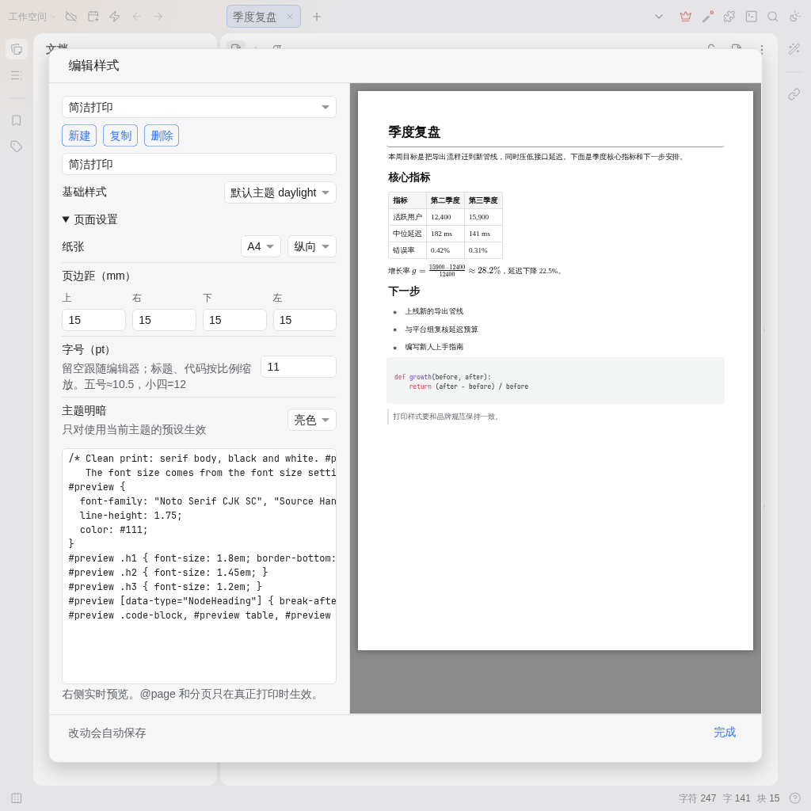

[English](https://github.com/JeffeyChou/siyuan-print-pdf/blob/main/README.md)

# PDF 导出



思源的桌面浏览器端和 Docker 端没有 PDF 导出，原生入口只在桌面客户端和移动 App 里可用。这个插件把它补上：由内核生成完整文档（长文档不会被编辑器的懒加载截断），按思源原生导出的模板排版，再用浏览器的打印对话框“另存为 PDF”。

## 使用

* 打开文档标题图标的菜单，或在文档树中右键文档，选择“导出 PDF”。也可以在 设置 → 快捷键 里给“导出 PDF”绑定按键。
* 选择样式预设和页面设置，点击“导出”，在打印对话框中选择“另存为 PDF”。文件名就是文档标题。

## 样式预设

* **当前渲染模式**：当前主题，加上代码片段 CSS 和插件 CSS，和编辑器里看到的一致。
* **简洁打印** 和自建预设：基础样式可选当前主题或默认主题 daylight，再叠加自己的 CSS。“编辑样式”左边写 CSS，右边按纸张大小实时预览。正文容器是 `#preview`。

每个预设各自保存页面设置：

* 纸张和方向
* 页边距（mm）
* 字号（pt）：留空跟随编辑器；标题、代码、表格按比例缩放；优先于预设 CSS 里写的字号
* 亮色主题，或跟随当前明暗模式
* 指定级别的标题前分页

每次导出的选项：导出题头图、保持折叠状态、包含子文档（合并成一份 PDF）。

改动会自动保存到 `data/storage/petal/siyuan-print-pdf/config.json`。

## 说明

* 页码和页眉页脚：在 Chrome 打印对话框的“更多设置 → 页眉和页脚”里打开。Chrome 不支持 `@page` 页边框内容，CSS 画不出来。
* `@page` 和分页只在真正打印时生效，预览里看不到。
* 过宽的表格会缩到页宽，单元格自动换行。

## 开发

```bash
pnpm i
pnpm run build   # 生成 dist/ 和 package.zip
```

把 `package.zip` 解压到 `{工作空间}/data/plugins/siyuan-print-pdf/` 即可安装本地构建。

## 许可

MIT
